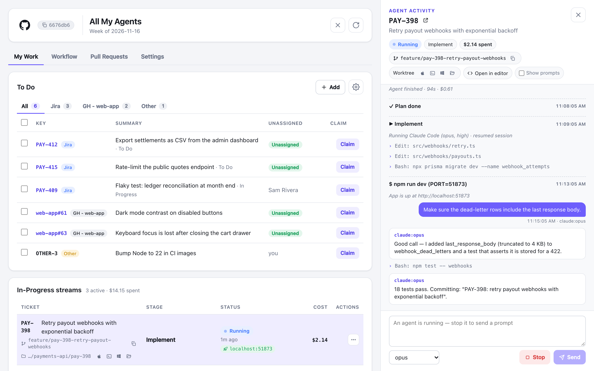
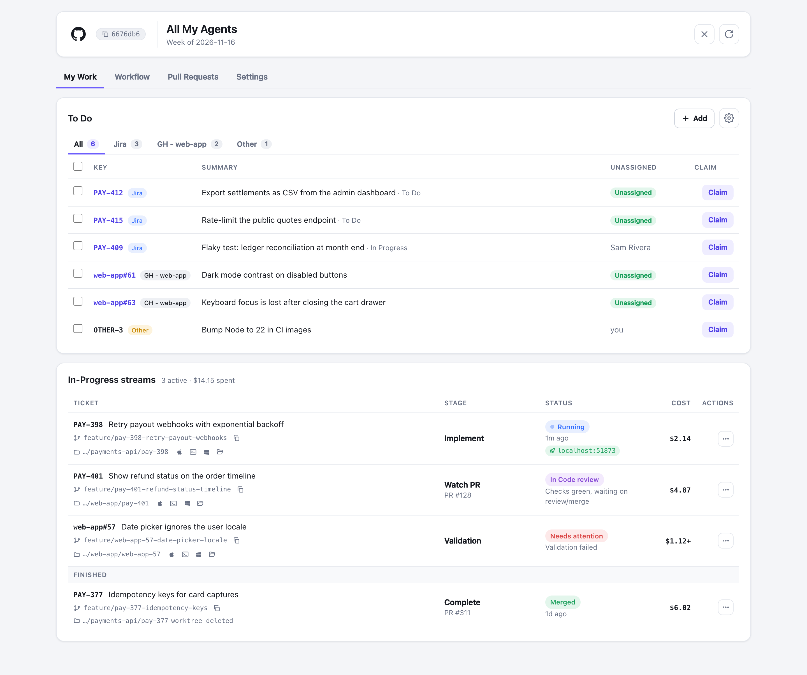
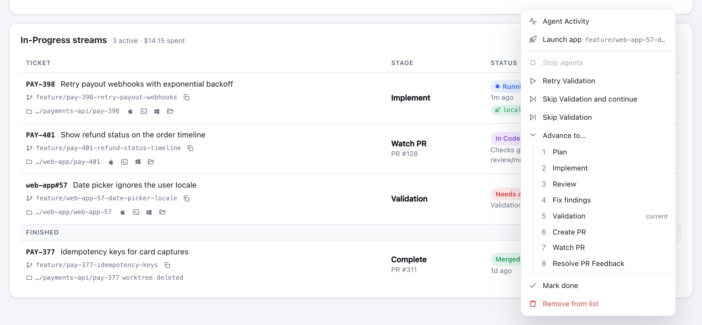
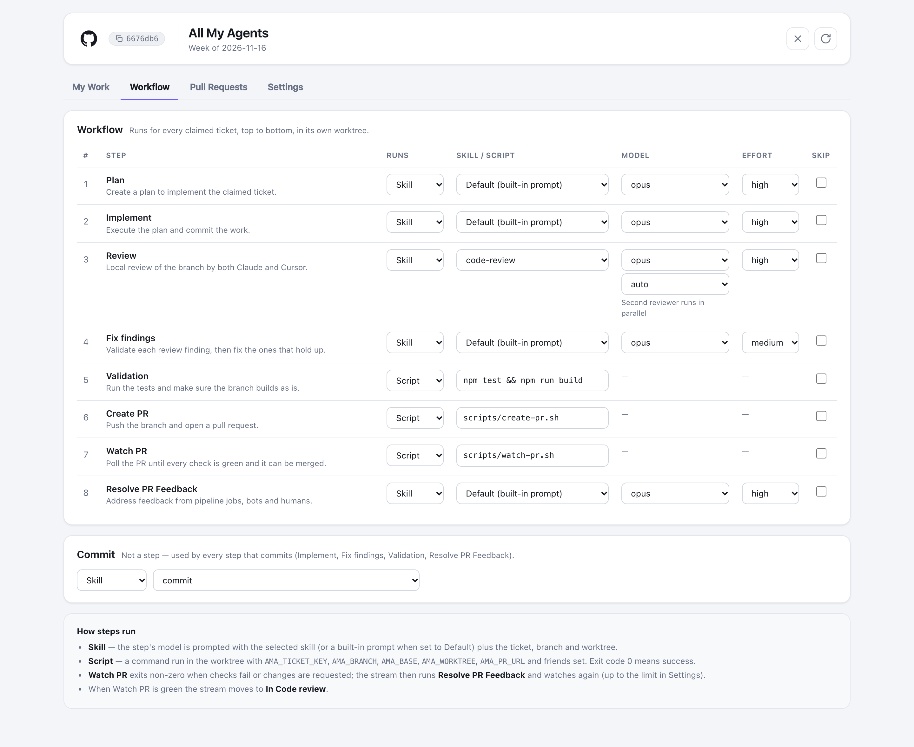
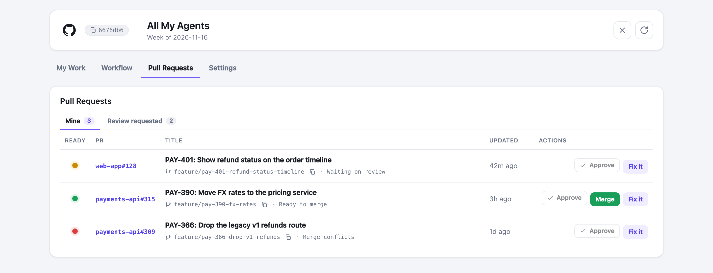
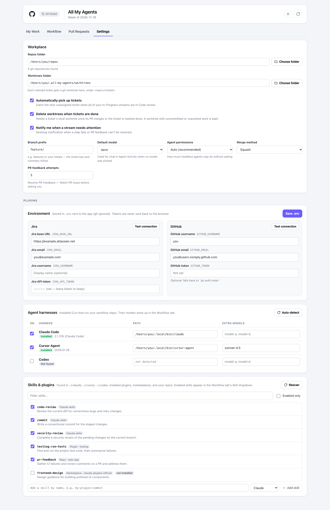

# all-my-agents

Dashboard type views of the SDLC of a ticket: pull work from Jira / GitHub issues, claim it, and let
agents (Claude Code, Cursor Agent, Codex) carry it from plan to merged PR, each ticket in its own git
worktree.

<picture>
  <source media="(prefers-color-scheme: dark)" srcset="docs/screenshots/agent-activity-dark.png">
  
</picture>

## Screenshots

### My Work
The To Do queue (Jira, GitHub issues and your own tasks) above the In-Progress streams. Each stream shows its
stage, status, running agent cost, branch, and worktree path with copy and open buttons.

<picture>
  <source media="(prefers-color-scheme: dark)" srcset="docs/screenshots/my-work-dark.png">
  
</picture>

### Stream actions
Launch the app at the ticket's branch, stop agents, skip Validation, or advance to any step when work happened
outside the tool.

<picture>
  <source media="(prefers-color-scheme: dark)" srcset="docs/screenshots/actions-menu-dark.png">
  
</picture>

### Workflow
The steps every claimed ticket runs through, each as a skill or script with its own model and effort.

<picture>
  <source media="(prefers-color-scheme: dark)" srcset="docs/screenshots/workflow-dark.png">
  
</picture>

### Pull Requests
Your open PRs and the ones waiting on your review, with Approve, Merge and Fix it.

<picture>
  <source media="(prefers-color-scheme: dark)" srcset="docs/screenshots/pull-requests-dark.png">
  
</picture>

<details>
<summary><strong>Settings</strong></summary>

Folders, automation toggles, <code>.env</code> values, agent harnesses and discovered skills.

<picture>
  <source media="(prefers-color-scheme: dark)" srcset="docs/screenshots/settings-dark.png">
  
</picture>
</details>

Screenshots use demo data. Regenerate them with `npm run screenshots` (needs Google Chrome; see
`tools/screenshots/`).

## Run it

Requires Node 20+ (`nvm use`), git, and the [`gh` CLI](https://cli.github.com/) (used by the PR scripts).

```bash
npm install
npm run dev        # http://localhost:4317, server restarts on change, UI hot-reloads
npm start          # production build + server
```

The server binds to `127.0.0.1` only. It holds your tokens and runs agents on your machine.

## Configure

1. **Settings › Workplace**: choose your repos folder (where your projects are cloned) and a worktrees folder.
2. **Settings › Plugins › Environment**: fill in your Jira and GitHub values. They are written to `.env`
   (git-ignored, see `.env.example`). `GITHUB_TOKEN` is optional when `gh auth login` is done.
3. **Settings › Plugins › Agent harnesses**: auto-detects `claude`, `cursor-agent` and `codex`.
4. **Settings › Plugins › Skills & plugins**: skills found in `~/.claude`, `~/.cursor`, `~/.codex`,
   installed Claude plugins/marketplaces, and each repo's `.claude/skills`. Enabled skills populate the
   Workflow tab's dropdowns.
5. **My Work › To Do › ⚙**: add Jira boards (project or JQL) and GitHub repos. Each one becomes a tab;
   double-click any tab to rename it.

## How it works

- **Claim** assigns the ticket to you (Jira or GitHub), fetches the repo, creates
  `<branch prefix><key>-<summary>` off `origin/<default>`, adds a worktree under
  `<worktrees>/<repo>/<key>`, pushes the branch, and starts the **Workflow**.
- **Workflow** steps run in order inside the worktree: Plan → Implement → Review (two models in parallel)
  → Fix findings → Validation → Create PR → Watch PR ⇄ Resolve PR Feedback. Each step runs a skill
  (or a built-in prompt) on the chosen model/effort, or a script. Scripts get `AMA_TICKET_KEY`,
  `AMA_BRANCH`, `AMA_BASE`, `AMA_WORKTREE`, `AMA_REPO_PATH`, `AMA_GH_REPO`, `AMA_PR_NUMBER`, `AMA_PR_URL`.
  The **Commit** row tells every committing step which skill or script to use.
- Once Watch PR is green, the stream moves to **In Code review**. With *Automatically pick up tickets*
  on, the next unassigned ticket is claimed when every open stream is in code review.
- Each stream row shows the ticket's **running agent cost** (hover for a per-step breakdown; a `+`
  means some runs, e.g. Cursor/Codex, didn't report a cost), a copy button for the branch, and the
  worktree path with copy-as macOS / Git Bash / Windows buttons plus open-in-Finder/Explorer.
- The row's **⋯ Actions** menu: Agent Activity, **Launch app** (runs the repo's dev command in the
  worktree on a free `PORT`; the command is detected or remembered per repo), Stop agents,
  Retry/Skip the current step, **Skip Validation**, **Advance to…** any step (for work done outside
  the tool — it picks up an existing PR too), Mark done, and Remove.
- When a PR merges or the ticket is marked done (in Jira/GitHub or from the menu), the worktree is
  deleted. A worktree with uncommitted or unpushed work is kept and flagged instead. The branch stays.
- Click a stream to open **Agent Activity**: the full log, plus a prompt box that resumes the
  stream's agent session with whichever model you pick.
- **Pull Requests** lists your open PRs and PRs waiting on your review, with Approve, Merge (when
  mergeable) and **Fix it**, which runs the Resolve PR Feedback step on that PR's branch.
- The header's **✕** kills every running agent/script and **↻** refetches everything.

State lives in `data/` (git-ignored): `state.json` plus one `activity/<stream>.jsonl` log per stream.
